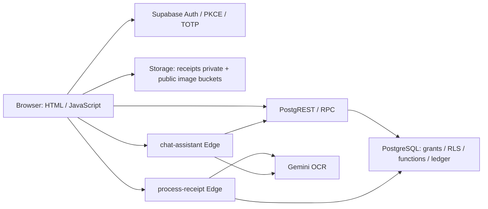

# MEEM STORE — تقرير التحقق الأمني والإصلاحات

**تقرير الحالة المثبتة بتاريخ 20 أكتوبر 2026، نحو 23:55 بتوقيت Africa/Khartoum.** العمل غير مكتمل كاختبار اختراق شامل: Strix لم ينفذ assessment بعد، وBoosthis لم يُربط. يميّز هذا التقرير بين الإثبات، والتنبيه، والتغطية المتعذرة.

## 1. النتيجة التنفيذية

أُثبت خلل **Medium واحد في تفويض Storage**: مدير لا يملك `manage_products` يستطيع الكتابة في صور الكتالوج. أُصلح في [PR #52](https://github.com/mohamdalsadiq/raizey-store.qw/pull/52)، وأعيد إثباته ثم اختبار الإصلاح على PostgreSQL staging مستقل. الإصلاح **لم يُطبّق على الإنتاج**، والـPR مسودة غير مدمجة.

ثبت أيضًا تضمين **Swiper 11.2.10 المتأثر بـCVE-2026-27212**. أُعيد إنتاج سلوك المكتبة بشروط إعلان المورد، ولم يثبت مسار يستغله عميل المتجر عن بعد. حُدّثت إلى 12.2.0 في الفرع المصحح وfrontend staging؛ هذه مشكلة تبعية Low في سياق المتجر، وليست إثباتًا لـCritical/RCE في المتجر.

| التصنيف | Critical | High | Medium | Low |
|---|---:|---:|---:|---:|
| ثغرات تطبيق مثبتة على الحالة الأصلية | 0 | 0 | 1 | 0 |
| مشكلة تبعية مثبتة، دون استغلال تطبيقي مثبت | 0 | 0 | 0 | 1 |
| ثغرات التطبيق المؤكدة الباقية في الإصلاح المختبر محليًا وSQL staging | 0 | 0 | 0 | 0 |
| ثغرات التطبيق المؤكدة الباقية في الإنتاج قبل نشر الإصلاح | 0 | 0 | 1 | 0 |

تبقى المكتبة القديمة أيضًا في الإنتاج حتى نشر frontend. التنبيهات غير المحسومة وغياب Strix وقراءة CodeQL Alerts تمنع تحويل الأرقام أعلاه إلى ضمان عام.

## 2. هوية النظام والبيئات

| العنصر | الحالة التي تحققت منها |
|---|---|
| المستودع | `mohamdalsadiq/raizey-store.qw`، عام؛ جُلب أحدث main دون force-push/reset |
| main والإنتاج | `d9ba6746c9d329bc13d04e671361b3395989eb6d` |
| نسخة الإصلاح المختبرة | `c8a98611f9884a775d5e4521d284bd4a10b7f7a6`، فرع `security/verified-audit-2026-10-20` |
| frontend staging | `0a029ed25011baca67f93a5c67692499a2141b5f`، فرع `security/isolated-staging-2026-10-20`، ليس فرعًا للدمج في main |
| Vercel | project `prj_CVjmTTwFlJ2ZPLMjlWgawcdmk5OZ`، static، Node 24، region iad1 |
| production deployment | `dpl_DsPrGHgWJ1PUCCLiyHAMQSDpM3Kf`، READY، نطاق [المتجر](https://raizey-store-qw.vercel.app) |
| staging deployment | `dpl_3ujB7VM9GDpjqxB7UuEuyRKtrPY5`، READY، target=null أي preview؛ لا تغيير لنطاق الإنتاج |
| عنوان staging فقط | [النسخة المعزولة](https://raizey-store-qw-git-security-isolated-staging-a4a7fd-pooortlen.vercel.app)، قد تحتاج صلاحية Vercel Authentication |
| Supabase الإنتاج | `rglbfizqolrenwfsndyv`، eu-central-1، PostgreSQL 17.6.1.155 |
| Supabase staging | `dvcsdbsnnbdpzaiccjej`، PostgreSQL 17.11.0.003، مشروع مستقل لا Branch |

الواجهة HTML/CSS/JavaScript متعددة الصفحات، وليست React/Next.js. الصفحات: الكتالوج والبحث والعروض والمنتج والسلة وcheckout والمحفظة والإيصال والطلبات والإحالات والإشعارات والحساب، وصفحات login/register/OTP/reset/MFA، وصفحات إدارة المنتجات والأقسام والبنرات والطلبات والشحن والأكواد والعروض والموظفين والإعدادات والتدقيق.

تحققت بقراءة HTTP من تطابق `/` و`assets/js/supabase-client.js` و`mfa-guard.js` وملف Swiper المنشور مع main، ومن ترويسات CSP وHSTS وnosniff وDENY. وتحقت بقراءة ملف العميل المنشور على staging من وجود ref الخاص بـstaging وغياب ref الإنتاج، ومن نشر Swiper 12.2.0 عليه.

### البيانات والنسخ الاحتياطية

أظهرت العدّات الفعلية في الإنتاج: **8 مستخدمين، 30 طلبًا، 10 payment_receipts، و3 محافظ برصيد غير صفري**. لا تكفي هذه العدّات لتمييز الحقيقي من التجريبي؛ عوملت كلها كبيانات فعلية. لم تُنسخ سجلاتها إلى staging، ولم تُعرض أسماء أو بريد أو أرقام حسابات أو قيم أرصدة في التقرير.

حُفظت محليًا لقطات metadata للدوال والسياسات والجداول والـgrants والقيود والفهارس، دون تصدير بيانات العملاء. لا يوجد ادعاء بإنشاء backup بيانات كامل؛ لم يُجر تغيير إنتاجي يستلزم استعادته. قبل نشر migration مستقبلًا يلزم حفظ تعريف السياسات المستهدف وخطة التراجع المحددة أدناه.

## 3. حدود الثقة وخريطة البيانات

الجداول: profiles/admin_permissions؛ الكتالوج products/categories/subcategories/store_sections/banners؛ المال orders/wallets/wallet_transactions/wallet_topups/payment_codes/payment_methods؛ الإيصالات payment_receipts/receipt_scan_results/receipt_fraud_attempts؛ coupons/coupon_redemptions/gift_cards؛ referral_milestones/referral_milestone_payouts؛ settings/store_settings/notifications/audit_logs/admin_audit_logs. توجد جداول private للحدود والـidempotency وقواعد الهاتف. جُردت 95 دالة، و108 سياسات، و112 قيدًا، و103 فهارس، ولم تظهر views في public.

| المسار | مدخل العميل | مصدر القرار والكتابة |
|---|---|---|
| شراء بالمحفظة | product/option/quantity/fields/coupon/request_id | execute_store_action ثم تسعير DB، coupon atomic، قفل wallet، orders + debit ledger في transaction |
| شراء بنكي | العناصر، method/reference/path، scan id | server scan ownership/expiry/method/amount، claim، orders pending_review؛ لا إتمام بقرار العميل |
| شحن | amount/method/reference/scan/path | binding لنتيجة الفحص، topup pending؛ admin_confirm_topup ثم credit + ledger |
| payment code/gift | code والعناصر | ملكية/صلاحية/حالة/قفل واستهلاك، مع منع إعادة الاستخدام |
| كوبون | code، وإجمالي للمعاينة | الاستهلاك والمبلغ النهائي داخل دوال الشراء؛ لا ثقة بسعر checkout المرسل |
| رد/إلغاء | order id وطلب الإجراء | ownership أو صلاحية المدير، transition checks، refund guards والـledger |
| إحالات/ولاء | referral عند التسجيل، ثم order id للمدير | الدور من DB؛ commission مرتبط بالطلب وحالته وعلم منع التكرار |
| إدارة | payloads وحقول العرض | صلاحيات DB/RPC؛ حراسة الصفحة وحدها ليست تفويضًا |

السعر والخصم والرصيد والحالة وrole وamount_verified ونتيجة OCR ليست حقائق يقررها العميل. يبدأ Auth بـpassword أو email OTP أو Google OAuth وPKCE، ثم guard لـTOTP؛ قاعدة البيانات وEdge context يرفضان AAL1 لمن لديه عامل verified. تخزين جلسة SDK في browser storage يجعل منع XSS مهمًا؛ لا يُوصف هذا التخزين وحده كثغرة مثبتة.

## 4. النتائج والإصلاح وإعادة الاختبار

| ID / النوع | الاسم والتصنيف | الشدة والأثر | الموضع | دليل إعادة الإنتاج | الإصلاح | ما بعد الإصلاح |
|---|---|---|---|---|---|---|
| MEEM-20261020-01 — ثغرة مؤكدة | Missing Authorization / Excessive Role Permission؛ OWASP A01:2021، API5:2023؛ CWE-862/863 | Medium: يتطلب حساب admin محدودًا، لكنه يسمح بتعديل/حذف صور عامة رغم سحب إدارة المنتجات منه؛ لا إثبات لسرقة أموال | storage.objects؛ السياسات product_images_admin_write/update/delete وcategory_icons_admin_write/update/delete؛ migration الجديدة الأسطر 5–15 | مدير اصطناعي `can_manage_products=false` مقابل مدير مخوّل. في staging، فشلت حالات الرفض الست قبل الإصلاح لأن الكتابات قُبلت؛ بقيت عمليات المدير المخوّل ناجحة | إضافة is_admin AND has_admin_permission('manage_products') إلى USING/WITH CHECK في العمليات الثلاث | 12/12 محليًا و12/12 على PostgreSQL staging. سياق DELETE يماثل Storage API؛ لم تُحذف ملفات فعلية. الإنتاج ما زال ينتظر migration |
| MEEM-20261020-02 — مشكلة تبعية مثبتة | Vulnerable Component / Prototype Pollution؛ CVE-2026-27212، CWE-1321، OWASP A06:2021 | Low في هذا المتجر: النسخة متأثرة وسلوك المكتبة مثبت؛ شرط PoC يتضمن تغيير built-in، ولم يثبت مصدر عميل يصل إلى extendDefaults بهذا الشكل | assets/vendor/swiper/swiper-bundle.min.js:2؛ package.json/lockfile؛ manifest | VM معزول طبق شرط إعلان المورد؛ القديم أظهر pollution=true. لا يُنسب هذا إلى استغلال عن بعد في التطبيق | Swiper 12.2.0 مثبتة، JS/CSS مطابقان لبصمات manifest؛ اختباران معزولان لـindexOf/includes | الاختباران يرفضان pollution، audit بلا advisories، و88 حالة متصفح للبنرات والمصادقة ناجحة؛ staging يخدم النسخة الجديدة، والإنتاج القديمة |

[إعلان Swiper الأصلي](https://github.com/nolimits4web/swiper/security/advisories/GHSA-hmx5-qpq5-p643) و[changelog](https://swiperjs.com/changelog). لم تُغيّر الأسعار أو سياسة الدفع أو صلاحيات أدوار أخرى لإرضاء الاختبارات.

## 5. قاعدة البيانات — تحقق مستقل

- **RLS الحي للقراءة:** معاملتان READ ONLY بهويتين مختلفتين من العملاء، مع إخراج عدّات فقط. رأى A وB ملفًا ومحفظة تخصهما، وصفرًا من ملفات ومحافظ وطلبات وإيصالات وصفوف صلاحيات الطرف الآخر. هذا اختبار دور PostgreSQL/claims، وليس تسجيل دخول فعليًا بمستخدمي Auth.
- **Source/live:** تعريفات الدوال الـ95 متطابقة بعد تطبيع whitespace. شُغلت التعريفات والسياسات الحية أيضًا محليًا، ونجحت 41 + 35 حالة. ملاحظة: وجود علامة auth.uid في CSV لا يثبت الأمان منفردًا؛ يُراجع مع body/grants والاختبارات.
- **staging الحقيقي:** نُقلت schema فقط، مع auth/storage الحقيقيين في المشروع الجديد. صححت الأذونات الافتراضية الواسعة للمشروع الجديد لتطابق grants الإنتاج، ثم نجحت مجموعات SQL: 35 للمال/الصلاحيات، و41 للمصادقة/البنرات، و12 لـStorage. انتهت جميعها بـROLLBACK.
- **التزامن الحقيقي:** طلبان متزامنان فقط، كل منهما 75 من محفظة اصطناعية 100. نجح واحد، ورجع الآخر insufficient_balance. النتيجة طلب واحد، debit=75، balance=25. حُذفت fixtures الاصطناعية المحددة، وتحققت عدّات users/orders/wallets/storage_objects=0 بعدها. لا اختبار ضغط.
- **Storage:** receipts private؛ product-images/avatars/banners/category-icons public. MIME المسموح JPEG/PNG/WebP؛ حدود 5 MiB للثلاثة الأولى، 2 MiB للبنرات، 200 KiB لأيقونات الأقسام. لم تُختبر خدمة رفع/حذف الملفات عبر HTTP على staging بعد.
- **grants/بحث المسارات:** روجعت grants الدوال وsearch_path والسياسات والقيود. `private.chat_rate_limits` بلا RLS، لكنه ليس public API ولا يوجد إثبات وصول عميل مباشر إليه؛ لا يُعد عدم RLS وحده استغلالًا. جدولان private لهما RLS بلا policies مقصودة للوصول الداخلي.
- **لا views عامة** ظهرت في inventory، فلا توجد حالة view security_definer مثبتة في هذه اللقطة.

### Security Advisor

الإنتاج: 3 تحذيرات anon SECURITY DEFINER، و39 authenticated، وتنبيها INFO لجدولين private، وتنبيه Leaked Password Protection disabled. لا تُعد 42 دالة ثغرات تلقائيًا.

الدوال العامة الثلاث: get_banners_public ترجع البنرات المنشورة النشطة؛ get_top_ordered_products ترجع تجميع منتجات نشطة مع حد 24؛ validate_referral_short_code ترجع valid/reason ولا هوية المُحيل. لم يثبت منها تسريب بيانات شخصية. دوال المستخدم تعتمد ownership/AAL/limits أو wrapper؛ دوال الإدارة تعتمد is_admin/permissions أو super_admin. تفاصيل inventory في `security-definer-review.csv` بالأدلة؛ لا يُقدّم هذا كإثبات ديناميكي مستقل لكل فرع من فروع كل دالة.

بعد ضبط staging: نفس أعداد SECURITY DEFINER، 3 و39، وتنبيها INFO؛ لم يظهر فيه تنبيه leaked-password. الإنتاج بقي disabled ولم يُغيّر. المنظمة Free؛ يلزم التحقق من إتاحة الميزة/الخطة قبل أي ترقية مدفوعة. [مرجع حماية كلمات المرور](https://supabase.com/docs/guides/auth/password-security#password-strength-and-leaked-password-protection)، [مرجع Advisor](https://supabase.com/docs/guides/database/database-linter?lint=0028_anon_security_definer_function_executable).

## 6. مراجعة #48 و#51 وCI والأسرار

PR #48 مدمج، merge commit `fcbcfe28441a4a4ddd6bbac8bac635e506d5f7cd`. تأكد وجود migration comprehensive_security_audit_fixes في القاعدة الحية، باسمها الفعلي وإصدار `20261018180723`؛ اختلاف timestamp اسم ملف المصدر لا يعني عدم التطبيق. كذلك onboarding وphone rules موجودتان. process-receipt المنشورة version 26 وchat-assistant version 7 تطابقان ملفات المصدر كاملة، بما فيها shared dependencies. frontend الحي المثبت أعلاه يطابق main. اختبار المسارات مجتمعة عبر HTTP/Auth الحقيقي ما زال غير مكتمل.

PR #51 ما زال مسودة مفتوحة على `452aef56fa287ca254939874a1f1d15dcf1b4f4c`. مراجعة [التشغيل 39474684198](https://github.com/mohamdalsadiq/raizey-store.qw/actions/runs/39474684198) أثبتت نجاح jobs الثلاثة: tests-and-dependencies، secrets، codeql. **CodeQL أنهى التحليل ورفع SARIF، لكن Alerts نفسها غير مقروءة بصلاحيات الاتصال الحالية**؛ محاولة gh/API لم تنجح، والأداة العامة ترفض endpoint الخاص بها. لا يُسجّل عدد alerts=0.

Gitleaks السابق 8.24.3 فحص 3 commits وفق log؛ لم أعتبره فحصًا كاملًا للسجل. نُزّل Gitleaks الرسمي 8.30.1 وتحقق checksum، وشُغّل git --log-opts=--all --redact=100. فحص 418 commits ونحو 14.10 MB. نُقّحت 16 نتيجة: 12 anon JWT مقصودة للعميل، و4 أسماء مفاتيح إعدادات في statements؛ لا service_role ولا سر خادم مثبت ضمن هذه النتائج، لذلك لم يجر تدوير غير لازم. لا يعني ذلك ضمان اكتشاف كل شكل من الأسرار.

لا توجد workflows على main من #51 بعد؛ لم أكررها في #52. استعلام runs للـcommit المصحح لم يُرجع تشغيل PR جديدًا. الفحوص المحلية وstaging موثقة، وفحوص CI السابقة تخص commitها فقط.

## 7. ZAP: فصل الإنذارات عن الإثبات

[التشغيل السابق 39476628470](https://github.com/mohamdalsadiq/raizey-store.qw/actions/runs/39476628470) نجح: 10 أنواع WARN، 0 FAIL، و57 PASS في log. artifact `zap_scan` موجود وغير منتهٍ، وبصمته `a50c136b88a9f8cda9eef0640c6dc61cec590857263e5f0cd69bdc344f3ae09d`، لكن تنزيل ZIP فشل بسبب صلاحيات/شبكة النقل. **لم أقرأ أمثلة URLs الأصلية الكاملة**؛ التصنيف الآتي مبني على log والتحقق الحالي، وليس نسبًا زائفًا لصفوف التقرير الأصلية.

| Alert | العدد في log | التحقق والتصنيف الحالي |
|---|---:|---|
| 10003 Vulnerable JS Library | 1 | مشكلة Swiper متأثرة ثبتت مستقلة في URL الحالي assets/vendor/swiper/swiper-bundle.min.js؛ ربطها بالـURL المحدد داخل artifact غير متاح |
| 10015 Cache-control | 4 | root وJS الحاليان static public بلا بيانات جلسة مضمّنة؛ headers مرصودة. لا تسريب cache مثبت؛ فحص URLs الأصلية مطلوب |
| 10027 Suspicious Comments | 11 | التعليقات ليست أسرارًا تلقائيًا؛ فحص الأسرار ومراجعة المصدر لم يثبتا secret ضمن النتائج. يحتاج أمثلة الأصل للحسم الكامل |
| 10049 Storable Content | 6 | التخزين المؤقت للأصول العامة مقصود؛ لا دليل على تخزين بيانات خاصة. لا تعميم على endpoints المصادق عليها غير المختبرة |
| 10050 Retrieved from Cache | 5 | Vercel HIT مرصود لأصول عامة؛ ليس ثغرة بحد ذاته |
| 10055 style-src unsafe-inline | 5 | موجود فعلًا لتنسيق الواجهة؛ hardening concern، دون XSS مثبت منه. script-src بقي self دون unsafe-inline/eval |
| 10098 Cross-Domain | 5 | ACAO=* مرصود على static root/JS العامة، دون credentials؛ لا BOLA أو تسريب مثبت. Edge لها CORS مستقل وJWT/DB authorization |
| 10109 Modern Web Application | 1 | معلومة عن قدرة scanner/التغطية، ليست ثغرة |
| 90003 Missing SRI | 5 | scripts الأساسية ذاتية الاستضافة؛ external font/style resources تحتاج مراجعة أمثلة الأصل. hardening، وليس استغلال supply-chain مثبتًا |
| 90004 Missing COEP | 5 | COEP غائب؛ ليس شرط أمان عامًا لكل متجر. لا استعمال مثبت لميزة تتطلب cross-origin isolation؛ لا يضاف عشوائيًا بما يكسر الأصول |

## 8. ما نُفّذ وما لم يظهر فيه خلل

| الفحص | النتيجة وحدودها |
|---|---|
| npm test | ناجح؛ receipt pipeline/judge/category icons، واختبارا vendor الجديدان |
| npm run test:edge | 94/94؛ HTTP/Supabase/Gemini mocks، لا استدعاءات AI مدفوعة |
| npm run test:security | 35 + 41 + 12، مع 245 مثال أرقام هاتف وتطبيق migrations مرتين |
| lint / build / typecheck | ناجحة؛ 85 scripts تُحلّل، وفحوص assets/CSP وبصمات vendor |
| npm audit | صفر advisories في lockfile المحدّث، بما فيه Swiper المثبتة الآن |
| اختبارات client إضافية | 16 security + 35 auth/banner client |
| browser | 88 حالة flows بHTTP fixtures ومكتبة SDK الحقيقية؛ 72 صفحة × viewport في smoke، ومنها redirects صحيحة للحسابات غير المسجلة |
| PostgreSQL staging | 88 حالة SQL بعد الإصلاح + اختبار طلبين متزامنين، مع نجاح المسارات المشروعة والتنظيف |

لم يظهر خلل في الاختبارات المحددة لعزل الصفوف، رفض AAL1، التلاعب بسعر العميل، quantity سالب، إعادة الطلب/idempotency conflict، replay للهدايا، binding وسيلة scan، منع ترقية الموظف، refund دون سك أموال، وتحديد محاولات أكواد الهدايا. لا يُعمّم نجاح حالة على كل حالات API.

راجعت سطح injection وXSS وSSRF والرفع والـredirect وCORS/headers والـmass assignment ومصدر قرارات المال. لا XML parser أو deserialization تنفيذي ظهر في مسارات الخادم المحددة؛ JSON لا يثبت XXE. fetch الخاص بالـOCR يتجه لمزوّد ثابت ويستقبل صورة bytes بدل URL يختاره العميل. اختبارات redirect هجومية موجودة، وXSS يفحص بالمعالجة حسب السياق؛ لم تُنفذ حملة DAST كاملة على كل sinks. CSRF يعتمد على غياب credential cookie تلقائي لمسارات المال واستخدام JWT Authorization، وليس على CORS وحده.

## 9. Strix والبيئة المعزولة

ثُبّت Strix 1.7.0 من المصدر الرسمي، commit `aa2036f22942eed3ecd142169289a256a2e7acb7`. فُحص --help فعليًا: deep/full/-n/instruction-file/max-turns/max-budget مدعومة. Docker daemon متاح عند التنفيذ بالصلاحية اللازمة. جُرّب auth status وauth login chatgpt --manual؛ الحالة Not signed in، والمسار يحتاج موافقة تفاعلية. أُلغي انتظار الدخول بدل طلب كلمة مرور أو استخدام API مدفوع.

يوجد ملف مستقل [PENTEST_SCOPE.md](PENTEST_SCOPE.md) بلا كلمات مرور أو مفاتيح. مصدر/DB staging وEdge Functions مجهّزة، وfrontend staging منشور ويتجه للـref المعزول. النسختان المنشورتان على staging version 1، مع secrets التلقائية لمشروعهما؛ لم تُنسخ مفاتيح Gemini الإنتاجية. إعداد origin الافتراضي local في نسخ staging، ومعاينات المشروع تطابق CORS regex الحالية. لا إثبات HTTP كامل لاستجابات Edge بسبب قيد الشبكة، ولا ادعاء اكتمال OCR الحقيقي.

الشبكة الحالية ترد CONNECT 403 للـSupabase staging من executor حتى خارج sandbox؛ هذا قيد allowlist، وليس فشل auth في التطبيق. يلزم فتح نطاق staging ونطاق Supabase الخاص به، وauth.openai.com وchatgpt.com، ثم إتمام دخول Strix. رابط Vercel مؤقت للوصول المحمي محفوظ محليًا خارج Git والأدلة العامة.

حسابات SQL A/B/admin كانت fixtures يُتراجع عنها؛ **لم تُجهّز بعد حسابات sign-in دائمة لاختبار browser→Auth→DB الحقيقي**. لا توجد تقارير Strix أو PoCs صادرة عنه، ولا يطلق على العمل Strix كاملًا. لم يُشغّل أي active scan على الإنتاج.

التكلفة: المنظمة Free، والمشروع المستقل عُرض بـ$0/شهر وأنشئ دون مورد مدفوع. لم يُستخدم Branching المعروض بـ$0.01344/ساعة. لا API LLM مدفوع ولا دفع أو رسائل أو اختبار DoS. فشل إنشاء مشروع Vercel جديد بـ403؛ نجح preview داخل المشروع القائم دون تغيير production.

## 10. Boosthis والأداء

راجعت [Help](https://www.boosthis.com/help) و[Before you install](https://www.boosthis.com/docs/before-you-install). المنتج يقيس Web Vitals والأخطاء، ولا يحل محل pentest أو functional suite. لا اتصال حساب Boosthis متاح. التوثيق يجعل إنشاء الحساب/المفتاح وSetup الخاص بالـkit خطوات مالك؛ الأرشيف وتعليمات التهيئة الخاصة لا تُخمن.

لم أضف script أو مفتاحًا وهميًا ولم أغيّر CSP. المسار المفضل لاحقًا kit ذاتي الاستضافة بعد مراجعة التوقيع/checksums، مع السماح الدقيق بـconnect-src للمصدر الرسمي فقط، ودون unsafe-inline للـscript أو فتح wildcard جديد. بيانات الأداء والأخطاء والـroute labels والـinstall identifiers ومخاطر إساءة مفتاح browser تستلزم مراجعة إعدادات الجمع قبل تشغيله. لا تُرسل passwords أو receipts أو جلسات ضمن labels.

| القياس — هاتف/سطح مكتب | قبل Boosthis | بعد Boosthis |
|---|---|---|
| LCP / INP / CLS / TTFB | غير مقاس كأداء منشور فعلي | غير متاح؛ لم يدمج |
| أخطاء التشغيل | فحص browser fixtures بلا exceptions في الحالات الـ88 | لا توجد بيانات Boosthis |

لا تستبدل screenshots والاختبارات الوظيفية أرقام Web Vitals. لم أفبرك قياسات قبل/بعد أو أصف تعديل Swiper بأنه تحسن أداء مقاس.

## 11. المتعذر وقرارات المالك

1. فتح allowlist للبيئة ثم دخول Strix التفاعلي؛ بعدهما فحص deep/full والتحقق من نتائجه وإعادة الاختبار. لا يوجد سبب لشراء API key قبل تجربة الاشتراك.
2. إتاحة CodeQL Alerts أو تصدير SARIF، وartifact ZAP الكامل؛ نجاح job وحده لا يحسمهما.
3. اختبار browser→Auth→Edge/Storage→DB الحقيقي بحسابين ومدير، دون email/SMS حقيقي. يشمل reset/OTP/session revocation والرفع وACL عبر HTTP. اختباراتنا موزعة بين fixtures وSQL، وليست end-to-end كاملة.
4. بعد استقرار الأمن: حساب ومفتاح/Setup Boosthis من المالك، ثم مراجعة الأرشيف والدمج وقياس قبل/بعد؛ لا ترقية أو تكلفة بلا قرار صريح.
5. Leaked Password Protection في الإنتاج، وأي ميزات خطة لازمة. لم أقرر تكلفة نيابة عن المالك.
6. تأكيد نموذج صلاحيات قراءة/إدارة الإيصالات بين أدوار المديرين؛ لا يُغيّر سلوك مالي أو صلاحية عمل قائمة دون إثبات ومتطلبات واضحة.

المراجعة الآلية رفضت مجموعة اختبارات SQL الكتابية على الإنتاج بسبب إنشاء users وتعديل settings/أرصدة/صلاحيات واستخدام session_replication_role رغم ROLLBACK. لم أتجاوز الرفض؛ نُفّذ البديل على staging، ونُفذت قراءات RLS الحية داخل READ ONLY فقط. لا حاجة لطلب إجازة تلك الكتابات الإنتاجية لإكمال البديل المعزول.

## 12. النشر والرجوع والأدلة

المسار المقترح بعد إكمال staging HTTP/Strix: مراجعة ودمج #52، تطبيق migration **restrict_catalog_storage_permissions فقط** على الإنتاج بعد حفظ تعريف السياسات الست، ونشر frontend المطابق. لا تنشر migrations تأسيس staging على الإنتاج. تعديل السياسة وvendor مستقلان، فلا يوجد نشر SQL/Edge/frontend متداخل جديد في هذا الإصلاح. Edge الإنتاج لم تتغير.

frontend يرجع بنشر Vercel السابق. إعادة السياسات القديمة تعيد الثغرة؛ البديل الآمن عند مشكلة تشغيل هو تصحيح manage_products للمدير المعني أو تعليق الكتابة مؤقتًا، لا فتحها لكل admin. فرع isolated-staging لا يدمج في main لأنه يغيّر ref ومفتاح العميل للبيئة الاختبارية.

الأدلة المنقّحة في [evidence-2026-10-20.zip](evidence-2026-10-20.zip): logs الفحوص النهائية، نتائج SQL قبل/بعد والتزامن والتنظيف، قراءات RLS غير المسماة، inventory مراجعة الدوال، HTTP headers ومقارنة المصادر، npm audit، triage Gitleaks، ولقطات fixtures. لم تُضمّن روابط bypass أو كلمات مرور أو server keys أو بيانات العملاء أو raw CI logs.

روابط العمل: [PR #48](https://github.com/mohamdalsadiq/raizey-store.qw/pull/48)، [PR #51](https://github.com/mohamdalsadiq/raizey-store.qw/pull/51)، [PR #52](https://github.com/mohamdalsadiq/raizey-store.qw/pull/52)، [CI السابق](https://github.com/mohamdalsadiq/raizey-store.qw/actions/runs/39474684198)، [ZAP السابق](https://github.com/mohamdalsadiq/raizey-store.qw/actions/runs/39476628470). لا رابط لتقرير Strix لم يُنتج.

## 13. أخطر خمس حمايات سابقة أعيد إثبات عملها

هذه إصلاحات سابقة من #48 أعيد التحقق منها، وليست خمس ثغرات جديدة أغلقتها هذه الجولة: رفض تجاوز MFA بـAAL1؛ تسعير الشراء على الخادم بدل سعر العميل؛ الحفاظ على نتيجة الإيصال الخادمية وربط وسيلة الدفع؛ refund/idempotency دون زيادة غير مشروعة للرصيد؛ ومنع ترقية الموظف/تجاوز صلاحيات الإدارة. أدلتها حالات SQL المسماة في الأرشيف. لا أعيد اختراع درجات Critical/High تاريخية دون إثبات الحالة الأصلية هنا.

**الخاتمة الدقيقة:** بقيت على الإنتاج ثغرة تطبيق مؤكدة واحدة Medium، إضافة إلى تبعية قديمة Low مثبتة، ولهما إصلاح مختبر في #52 وstaging. بقي صفر من ثغرات التطبيق المؤكدة التي أُعيد اختبار إصلاحها ضمن نطاق SQL/local المحدد، مع بقاء فجوات Strix وCodeQL Alerts وHTTP end-to-end والأداء. لا يُستنتج من ذلك أن الموقع خالٍ 100% من الثغرات، ولا يكتمل تسليم pentest النهائي قبل معالجة هذه الحدود.

## استئناف 21 أكتوبر 2026 — 01:19 بتوقيت الخرطوم

بعد إفادة المالك بنشر العناوين الخمسة، تحققت من الحالة الفعلية مجددًا. البيئة running، وobservations_current=true، والإصدار المطلوب والمطبق كلاهما revision 8، لكن network_policy.state=enforced مع allowed_hosts=[]؛ وملف /etc/codex/network-policy.json لا يتضمن العناوين الخمسة. أعاد اتصال staging وauth.openai.com خطأ CONNECT 403 من proxy. لا يثبت ذلك سبب اختلاف الإعداد المنشور عن البيئة؛ يثبت أن نفاذ الشبكة المطلوب لم يصل إلى executor الحالي.

أُعيد تشغيل مسار Strix ChatGPT login الفعلي، ووصل إلى خطوة موافقة المتصفح، ثم أُلغي الانتظار قبل جمع أي بيانات دخول لأن تبادل OAuth سيبقى محجوبًا. لم يبدأ assessment ولم تُنتج نتائج Strix. أُعيدت محاولة قراءة CodeQL Alerts فرفضها API، وأرجع اتصال GitHub مرجع artifact ZAP لكن نقل ZIP أعاد 403؛ لم تُقرأ أمثلته الكاملة. لا تغيّر هذه المحاولات أعداد النتائج الأمنية السابقة ولا تعني نجاح الفحص.

الخطوة اللازمة الآن: مزامنة/إعادة نشر إعداد HTTP allowlist ذي العناوين الخمسة على البيئة المرتبطة بهذه المحادثة وإعادة تشغيلها، ثم التحقق من ظهورها في السياسة النافذة. التفاصيل المنقحة في NETWORK_RECHECK_2026-10-21.json؛ لا روابط OAuth أو tokens أو bypass ضمن هذا التحديث. لم تتغير شيفرة التطبيق أو بيانات الإنتاج.
